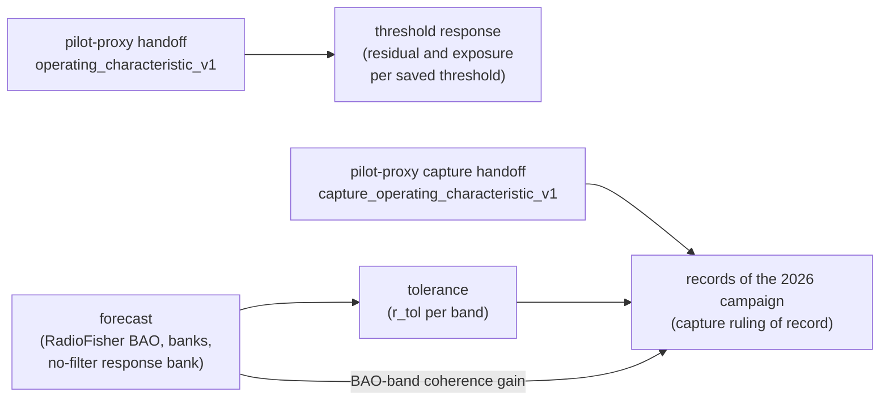

# RFIsher

RFIsher is the science side of a detector/science split for radio-frequency
interference in 21 cm intensity mapping: it decides what a detector's masking
is worth to a cosmological measurement. The detector side,
[pilot-proxy](https://github.com/WVURAIL/pilot-proxy), characterizes each
band (every candidate threshold with its masked fraction and kept residual);
RFIsher turns a Fisher forecast into a tolerance on that residual, checks
same-mask responses against fixed precision and calendar budgets, and holds
the code of record of the 2026 capture ruling. It also prices masking as
observing-time cost, the use it was first written for.



Cosmology enters through `rfisher.forecast` and `rfisher.tolerance`, and two
things leave them: `tolerances.csv` and the BAO-band gain, the latter for the
capture ruling of record only. [docs/HANDOFF.md](docs/HANDOFF.md) says
what this side reads from the detector and gives the reading path through the code;
[docs/cosmology-entry.md](docs/cosmology-entry.md) explains the tolerance for
an engineer; [docs/adapting.md](docs/adapting.md) says how to add a science
model.

The current release ships a CHIME, ATSC DTV, and 21 cm BAO reference
application. Its public scenario and bank boundaries are designed for other
bands and instruments, but its installed forecast targets and builders are
still CHIME/BAO-specific. RFIsher should not yet be described as a
target-independent Fisher package.

## Quickstart

Three provenance-complete CHIME banks ship with the package, so the basic
workflow does not require a RadioFisher checkout:

```python
from rfisher.forecast.radiofisher_bao import api, scenarios

fc = api.load()                                   # the default cmbspa2026 bank
mask = {17: 0.33, 30: 0.97, 31: 0.24}             # masked-time fractions

api.required_time(fc, mask, target=5.0)           # survey BAO target
api.required_time(fc, mask, target=5.0, zbin=6)   # one redshift bin
api.significance(fc, 2.0, mask)                   # after two on-sky years
api.masking_cost_curve(fc, band=scenarios.DTV_BAND)  # masking-cost curve
```

`examples/minimal_example.py` runs this calculation in a few seconds. A
continuous band works through the same scenario interface:

```python
n71 = scenarios.FrequencyBand(
    "5g_n71_downlink", 617.0, 652.0, label="5G n71 downlink")
scenario = scenarios.Scenario(
    "n71",
    "ATSC and 5G n71 downlink",
    fractions={17: 0.33, 31: 0.24},
    frequency_fractions={n71: 0.15},
)

api.required_time(fc, scenario, target=5.0)
```

Banks use the strict schema-v2 contract. Pre-provenance banks are rejected
and must be rebuilt.

## What is being priced

RFIsher keeps two costs separate:

- **Masking cost:** masking a fraction `f` retains `(1 - f)` of the effective
  integration time. Complete excision is priced as lost survey volume.
- **Contamination residual:** retained data can carry residual power `r`
  relative to thermal noise. In the incoherent variance model, the effective
  time factor becomes `(1 - f) / (1 + r)`.

Coherent contamination is a bias problem, not simply extra variance. The
dedicated bias-response workflow propagates it through a `_Pres` Fisher row
and refuses unsupported or numerically unstable evaluations.

Threshold selection is split at the handoff. The detector (pilot-proxy)
characterizes each band: every candidate threshold with its masked fraction,
kept residual and evaluability, the false-alarm limit eta_Pfa (the smallest
fixed-rank threshold whose one-sided 95% Clopper-Pearson upper bound is at
most alpha = 0.001 on the band's own independently sampled verified null,
the rank fixed before the scores are read; see pilot-proxy's
`docs/HANDOFF.md`; a control band's threshold is a surrogate and never a
band's eta_Pfa), and the stability screen
(`oc_table.csv`, `oc_summary.csv` and
`manifest.json`, schema `operating_characteristic` v1).
`rfisher.verdict.handoff` checks those files, and `rfisher response threshold`
exports the saved residual and exposure curves of a complete handoff without
selecting a threshold ([threshold response](docs/threshold_response.md)).

No post-processing of the residual (a delay filter, a ground filter or any
other downstream stage) is modelled: no factor multiplies a residual, and the
tolerance is the forecast's without a delay filter.

Every science choice is an entry of the project's two registers,
`projects/chime_bao/science_register.json` and `selector_policy.json`, read
through `rfisher.policy`, with its value, units, basis, status, rationale,
evidence and sensitivity values; the detector's choices are entries of
pilot-proxy's register.

The code of record of the 2026 campaign is `rfisher records`: the frozen
archive release layouts, and the capture ruling of record (release r5.2 and
its table of record) from the capture handoff. `records/` is frozen code of
record: its credit and 200 ns switches (`GROUND_CREDIT`, `WORLD`, `KEEP`) exist
only to reproduce the table of record, and no current rule enables them; the
latest rule, r5_3, resolves `GROUND_CREDIT=off`, `WORLD=none` and
`KEEP=stated`, which `tests/test_repository_hygiene.py` checks.

## Shipped reference result

The reference application reproduces the CHIME Overview BAO forecast before
applying masking. Selected masking-only results are:

| Scenario | Survey time penalty | Time for 2% transverse distance at z=1.40-1.50 |
|---|---:|---:|
| No masking | 1.00x | 0.32 on-sky yr |
| 50% of the DTV band masked | 1.15x | 0.63 on-sky yr |
| Channel 30 excised | 1.008x | 0.36 on-sky yr |
| Channel 30 retained, Fourier convention | 1.06x | 1.96 on-sky yr |

The masking-cost driver that wrote these, `scripts/run_forecast.py@c7c3949`,
is kept in the history. Absolute Fisher times are model-dependent; masking ratios are the more robust
comparison. See [the CHIME/BAO application](docs/application-chime.md) for
the full inputs, results, and caveats.

## Documentation

- [Tolerance](docs/tolerance.md): the masking-cost and contamination-residual
  models in force.
- [Fixed precision and calendar budgets](docs/FIXED_PRECISION_CALENDAR.md):
  same-mask responses against the fixed clean-reference precision
  (`rfisher response calendar`).
- [Visibility response](docs/visibility-response.md): the 10-second
  visibility product carried through a fixed science response.
- [Where cosmology enters](docs/cosmology-entry.md): the tolerance and the
  refused bands, for an engineer.
- [Threshold response](docs/threshold_response.md): exact saved fine thresholds,
  residual proxies, and uniform exposure costs.
- [Decision register](docs/decision-register.md): every science and selector
  entry with its value, status and evidence.
- [Architecture and scope](docs/architecture.md): component boundaries,
  bank contract, backend hooks, and the current generality limit.
- [The handoff](docs/HANDOFF.md): what this side reads from the detector,
  and the reading path through the code.
- [Adapting](docs/adapting.md) and [terminology](docs/terminology.md).
- [CHIME/BAO reference application](docs/application-chime.md): fiducial
  configuration, headline results, inputs, and application-specific caveats.
- [Reproducibility](docs/reproducibility.md): installation, verification,
  bank builds, dissertation checks, and evidence regeneration.
- [Verification benches](docs/testing.md): component coverage, numerical
  oracles, CI coverage gates, and optional integration checks.
- [Release index](docs/releases.md): immutable existing releases and the
  layout for future releases.

## Install and verify

```bash
git clone https://github.com/WVURAIL/RFIsher
cd RFIsher
python -m pip install -e ".[test]"
python -m pytest tests/ -q
```

Generated results, including the frozen releases, live outside the
repository in the workspace `results/` tree. See
[releases](docs/releases.md).

The command-line entry points are:

New forecasts default to the August 2026 combined cosmology. Bull's Planck
2013 and Foreman's Planck 2018 inputs remain explicit reproduction options;
see [cosmologies](docs/cosmologies.md) for the three primary roles.

```bash
rfisher forecast --uniform 0.25
rfisher forecast --cosmology cmbspa2026 --uniform 0.25
rfisher build-bank --help
rfisher tolerance show
rfisher response --help
rfisher records --help
```

RadioFisher is needed only to build a bank or perform direct backend
validation. After installing the pinned checkout, run
`python scripts/verify_bank.py`. See
[reproducibility](docs/reproducibility.md) for the exact setup.

## Project boundary

[pilot-proxy](https://github.com/WVURAIL/pilot-proxy) owns detector kernels,
survey-product generation, and the underlying masking measurements.
[RadioFisher](https://github.com/WVURAIL/RadioFisher) supplies the supported
Fisher backend: the integrand and the instrument-agnostic hooks that cut or
weight it, in the backend's own units. RFIsher validates those inputs, maps
them to masking and contamination-residual scenarios, supplies every
survey-specific number, decision, and dataset the hooks consume, and prices
the scientific effect.

The immutable historical releases retain their original paths, filenames,
schema identifiers, and provenance fields. They are indexed in
[docs/releases.md](docs/releases.md).

## Citation

If this software feeds a publication, cite RadioFisher (Bull, Ferreira, Patel,
and Santos, *ApJ* 803, 21, 2015; arXiv:1405.1452) for the forecasting
formalism and pilot-proxy for the masking measurements. Project citation
metadata are in `CITATION.cff`.
