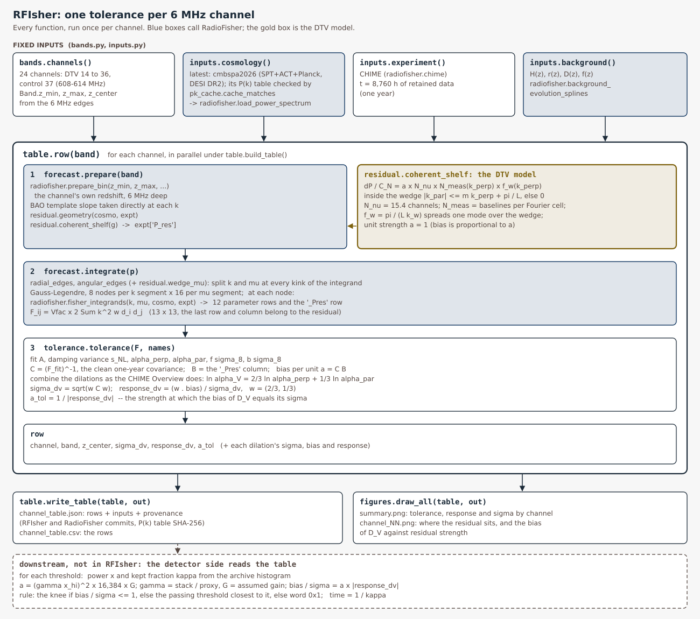
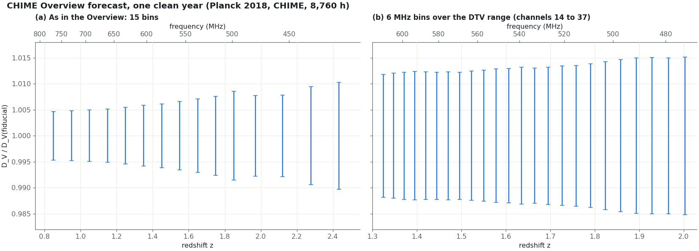
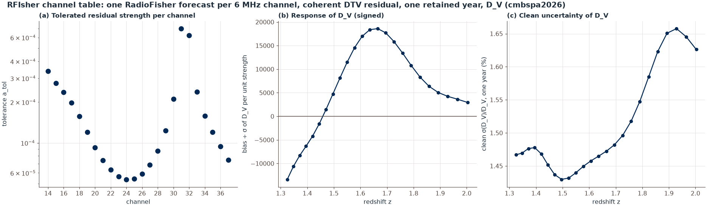

# RFIsher

How much residual DTV power each 6 MHz channel can carry before it biases a 21 cm BAO
measurement by more than its own uncertainty.

For each channel, RFIsher runs one [RadioFisher](https://github.com/WVURAIL/RadioFisher)
forecast at the channel's own redshift, with CHIME as in the CHIME Overview and one
retained year of data. The two BAO dilations are combined into the one number the
CHIME Overview reports, the volume-averaged distance D_V
(`ln α_V = 2/3 ln α⊥ + 1/3 ln α∥`). The forecast gives its clean uncertainty σ. A
coherent DTV residual of unit strength is added through RadioFisher's residual hook,
and the forecast returns the bias it causes in D_V. Bias is proportional to the
residual's strength `a`, so each channel reduces to one **response** (bias ÷ σ per unit
strength) and one **tolerance**:

    a_tol = 1 / |response_dv|

A residual weaker than `a_tol` biases D_V by less than its σ.

The table of these numbers is RFIsher's only output. It does not depend on the
detector's calibration: a new threshold, era or mask never needs a new table. Only a
new cosmology, telescope, residual model or retained-time anchor does.



## Use

```bash
python -m pip install -e .            # installs RadioFisher at the pinned commit
rfisher table --out out/              # all 24 channels, about a minute on 12 cores
rfisher figures --out out/figures     # the summary and one plate per channel
rfisher overview --out out/overview   # the CHIME Overview forecast, reproduced and in 6 MHz channels
```

```python
import rfisher
table = rfisher.read_table()          # the shipped table
row = next(r for r in table["channels"] if r["channel"] == 19)
a = 8.4e-8                            # residual strength at a threshold (detector side)
bias_over_sigma = a * abs(row["response_dv"])
```

## Reference: the CHIME Overview forecast

`rfisher overview` reproduces the CHIME Overview forecast the way its scripts compute it:
RadioFisher's own `fisher()` per redshift bin, A, bσ8, fσ8 and the two dilations free in
each bin, σ_NL shared by all bins, and the dilations combined into D_V. On the Overview's
15 bins it reproduces the clean one-year errors, 0.47% to 1.03%, to within 0.0003
percentage points. The same forecast with 6 MHz bins over the DTV range gives 1.18% to
1.52% per channel: each bin is about a quarter as deep, so its error is about twice as
large. The tolerance table's clean σ(D_V) agrees with it to within 1.5% on every
channel; the table integrates more finely and fits σ_NL per channel.



## How the detector side uses the table

For each candidate threshold, the archive histogram gives the DTV power `x` left in the
kept frames (relative to the noise on one input) and the kept fraction κ. Then:

1. The residual strength is `a = (c x)² × 16,384 × G`. Here `c` is the coherent fraction
   of the power, 16,384 the samples in one frame, and `G` the frames it stays coherent,
   taken as one frame, as in the captures.
2. The bias of D_V in units of its σ is `a × |response_dv|`.
3. The threshold passes if that is at most 1, using the power plus two standard errors.
   The rule takes the knee if it passes, otherwise the passing threshold closest to the
   knee, otherwise word 0x1. pilot-proxy holds a copy of this table and the rule.
4. The calendar time to collect the retained year is `1 / κ` years.

κ never enters the forecast. The forecast is always for one retained year; κ only says
how long collecting it takes.

## The model

- **Inputs** (`inputs.py`): Planck 2018 with its linear P(k) table, checked against the
  cosmology before use; CHIME as in the CHIME Overview (4 cylinders × 256 feeds,
  T_sys = 55 K, 31,000 deg², 0.39 MHz channels, as-built baseline density); 8,760 h of
  retained data.
- **Fit** (`tolerance.py`): A, σ_NL, α⊥, α∥, fσ8 and bσ8 are fitted; the rest are held
  at the fiducial. The dilations are combined into D_V as the CHIME Overview does. The
  bias is first order and compared with the clean σ of D_V. Where the two dilations'
  biases have opposite signs they partly cancel in D_V (channels 14 to 16 and 30 to 31).
- **Residual** (`residual.py`): one transmitter's power as a flat 6 MHz shelf that stays
  coherent. It puts the same visibility on every baseline that measures a Fourier cell,
  so it sits inside the horizon wedge. Relative to the noise power,
  `dP / C_N = a × N_ν × N_meas(k⊥) × f_w(k⊥)` for `|k∥| ≤ m k⊥ + π/L`, and zero outside.
- **Quadrature** (`forecast.py`): Gauss–Legendre in k and μ, split at every kink of the
  integrand. Doubling either order changes the tolerance by less than 3 × 10⁻⁷.

## The table

24 channels: DTV allocations 14 to 36 and channel 37, which carries no DTV and
serves as the control. σ is the clean one-year uncertainty of D_V in percent; the
response is signed.

| Channel | MHz | z | σ(D_V)/D_V (%) | Response | a_tol | |
|---|---|---|---|---|---|---|
| 14 | 470–476 | 2.003 | 1.50 | -587 | 1.70e-03 | [plate](docs/figures/channel_14.png) |
| 15 | 476–482 | 1.965 | 1.51 | -390 | 2.56e-03 | [plate](docs/figures/channel_15.png) |
| 16 | 482–488 | 1.929 | 1.51 | -117 | 8.55e-03 | [plate](docs/figures/channel_16.png) |
| 17 | 488–494 | 1.893 | 1.49 | +504 | 1.98e-03 | [plate](docs/figures/channel_17.png) |
| 18 | 494–500 | 1.858 | 1.46 | +1,712 | 5.84e-04 | [plate](docs/figures/channel_18.png) |
| 19 | 500–506 | 1.824 | 1.42 | +3,568 | 2.80e-04 | [plate](docs/figures/channel_19.png) |
| 20 | 506–512 | 1.791 | 1.38 | +5,946 | 1.68e-04 | [plate](docs/figures/channel_20.png) |
| 21 | 512–518 | 1.758 | 1.35 | +8,566 | 1.17e-04 | [plate](docs/figures/channel_21.png) |
| 22 | 518–524 | 1.726 | 1.33 | +11,068 | 9.04e-05 | [plate](docs/figures/channel_22.png) |
| 23 | 524–530 | 1.695 | 1.31 | +13,132 | 7.61e-05 | [plate](docs/figures/channel_23.png) |
| 24 | 530–536 | 1.665 | 1.30 | +14,379 | 6.95e-05 | [plate](docs/figures/channel_24.png) |
| 25 | 536–542 | 1.635 | 1.30 | +14,538 | 6.88e-05 | [plate](docs/figures/channel_25.png) |
| 26 | 542–548 | 1.606 | 1.28 | +13,499 | 7.41e-05 | [plate](docs/figures/channel_26.png) |
| 27 | 548–554 | 1.578 | 1.27 | +11,315 | 8.84e-05 | [plate](docs/figures/channel_27.png) |
| 28 | 554–560 | 1.550 | 1.25 | +8,271 | 1.21e-04 | [plate](docs/figures/channel_28.png) |
| 29 | 560–566 | 1.523 | 1.24 | +4,794 | 2.09e-04 | [plate](docs/figures/channel_29.png) |
| 30 | 566–572 | 1.496 | 1.22 | +1,251 | 8.00e-04 | [plate](docs/figures/channel_30.png) |
| 31 | 572–578 | 1.470 | 1.22 | -2,069 | 4.83e-04 | [plate](docs/figures/channel_31.png) |
| 32 | 578–584 | 1.445 | 1.22 | -4,960 | 2.02e-04 | [plate](docs/figures/channel_32.png) |
| 33 | 584–590 | 1.420 | 1.23 | -7,265 | 1.38e-04 | [plate](docs/figures/channel_33.png) |
| 34 | 590–596 | 1.395 | 1.23 | -8,954 | 1.12e-04 | [plate](docs/figures/channel_34.png) |
| 35 | 596–602 | 1.371 | 1.22 | -10,194 | 9.81e-05 | [plate](docs/figures/channel_35.png) |
| 36 | 602–608 | 1.348 | 1.20 | -11,333 | 8.82e-05 | [plate](docs/figures/channel_36.png) |
| 37 (control) | 608–614 | 1.325 | 1.18 | -12,600 | 7.94e-05 | [plate](docs/figures/channel_37.png) |



Each plate shows where the residual sits in Fourier space at the tolerated strength,
and how the bias of D_V grows with strength.

## Files

| File | Contents |
|---|---|
| `src/rfisher/bands.py` | the channels and their redshifts |
| `src/rfisher/inputs.py`, `pk_cache.py` | the fixed forecast inputs and the P(k) table check |
| `src/rfisher/residual.py` | the coherent DTV residual |
| `src/rfisher/forecast.py` | one channel's Fisher matrix with the residual's bias row |
| `src/rfisher/tolerance.py` | σ and bias of D_V, response and tolerance |
| `src/rfisher/overview.py` | the CHIME Overview forecast, reproduced, and in 6 MHz channels |
| `src/rfisher/table.py`, `figures.py`, `cli.py` | the table, the figures, the command line |
| `src/rfisher/data/channel_table.json`, `.csv` | the shipped table, with provenance |
| `docs/diagram.py` | draws the call graph above |

## Tests

```bash
python -m pip install -e ".[test]"
python -m pytest -q
```

One test rebuilds channel 19 and checks it against the shipped table to 1e-6 (other numpy
and scipy builds differ by about 1e-9). CI also rebuilds
channels 14, 29 and 37 against RadioFisher at the pinned commit.
