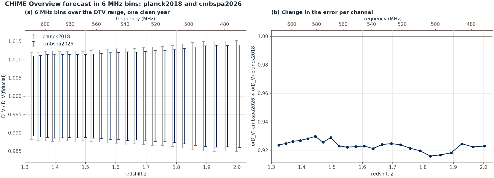

# RFIsher

How much residual DTV power each 6 MHz channel can carry before it biases a 21 cm BAO
measurement by more than its own uncertainty.

For each channel, RFIsher runs one [RadioFisher](https://github.com/WVURAIL/RadioFisher)
forecast at the channel's own redshift, with CHIME as in the CHIME Overview on the
inter-cylinder baselines CHIME's analyses use, the specified cosmology and one retained year of data. The two BAO dilations are combined into the one number the
CHIME Overview reports, the volume-averaged distance D_V
(`ln α_V = 2/3 ln α⊥ + 1/3 ln α∥`). The forecast gives its clean uncertainty σ. A
coherent DTV residual of unit strength is added through RadioFisher's residual hook,
and the forecast returns the bias it causes in D_V. Bias is proportional to the
residual's strength `a`, so each channel reduces to one **response** (bias ÷ σ per unit
strength) and one **tolerance**:

    a_tol = 1 / |response_dv|

A residual weaker than `a_tol` has a first-order assigned bias below its σ.

The table of these numbers is RFIsher's main output. It does not depend on the
detector's calibration: a new threshold, era or mask never needs a new table. Only a
new cosmology, telescope, residual model or retained-time anchor does.

The optional [finite BAO-only likelihood check](docs/NONLINEAR_BIAS_CHECK.md)
tests the local bias approximation against an explicitly defined nonlinear
model. It records unsuccessful fits and numerical checks, keeps the published
table fixed, and does not calibrate the physical residual or sampling coverage.


## Use

Start in a new directory with Git and Python 3.10 or newer. This path needs
no telescope data, credentials, GPU, or TeX installation.

```bash
git clone https://github.com/WVURAIL/RFIsher.git
cd RFIsher
python3 -m venv .venv
. .venv/bin/activate
python -m pip install -e ".[test]"
```

The install selects the recorded RadioFisher revision. Keep that pin for
reproduction; use a separate environment to develop RadioFisher's latest source.
Read the shipped table first:

```bash
python - <<'PY'
import rfisher
table = rfisher.read_table()
row = next(r for r in table["channels"] if r["channel"] == 19)
print(f"Channel 19: response = {row['response_dv']:.0f}, a_tol = {row['a_tol']:.3g}")
a = 8.4e-8  # illustrative residual strength, not a measured calibration
bias_over_sigma = a * abs(row["response_dv"])
print(f"First-order bias / sigma = {bias_over_sigma:.3g}")
PY
```

This prints approximately `response = 8344, a_tol = 0.00012` and
`First-order bias / sigma = 0.000701`. To rebuild one channel and check it:

```bash
rfisher table --channels 19 --workers 1 --out out/first-run
rfisher figures --table out/first-run/channel_table.json --out out/first-run/figures
python -m pytest tests/test_table.py -q
```

The forecast writes `channel_table.json` and `channel_table.csv`. The figure
command reads that new table; without `--table`, it would read the shipped table.
The tests compare the rebuilt channel with the shipped result using the
numerical tolerances described below.

For the full calculation:

```bash
rfisher table --out out/all --workers 12
rfisher figures --table out/all/channel_table.json --out out/all/figures
rfisher overview --out out/overview --workers 12
```

Set `--workers` to suit the machine. See [the paper/code contract](docs/PAPER_CODE_MAP.md)
to trace each quantity, or PilotProxy's
[first-run walkthrough](https://github.com/WVURAIL/pilotproxy/blob/main/docs/FIRST_RUN.md)
to continue from this response table to the paper's conditional thresholds.

## Reference: the CHIME Overview forecast

`rfisher overview` reproduces the CHIME Overview forecast the way its scripts compute it:
RadioFisher's own `fisher()` per redshift bin, A, bσ8, fσ8 and the two dilations free in
each bin, σ_NL shared by all bins, and the dilations combined into D_V. On the Overview's
15 bins it reproduces the clean one-year errors, 0.47% to 1.03%, to within 0.0003
percentage points. The same forecast with 6 MHz bins over the DTV range gives 1.18% to
1.52% per channel: each bin is about a quarter as deep, so its error is about twice as
large. The reproduction counts every baseline, as the Overview's forecast does
(RadioFisher's as-built density), so it still matches the published numbers. The tolerance
table does not: CHIME's analyses drop the pairs within one cylinder, which carry noise
cross-talk and a strong response to diffuse Galactic emission (CHIME Collaboration 2025,
arXiv:2511.19620), and the stack-to-proxy amplitude ratio used with the table is measured between
cylinders. Without those baselines the table's clean σ(D_V) is 17% to 34% larger than on
all of them. On all baselines it agrees with the reproduction to within 1.5% on every
channel; the table integrates more finely and fits σ_NL per channel.


The forecast inputs carry two cosmologies: the adopted `cmbspa2026`, which the table
uses (SPT-3G, ACT and Planck CMB with DESI DR2 BAO; Omori et al. 2026, arXiv:2608.31136v1,
Table 8), and the Overview's Planck 2018, which the reproduction uses so it can be checked. Only the cosmological
parameters and the P(k) table change; the HI models, σ_NL and CHIME stay the Overview's.
In the specified cosmology the 6 MHz errors are 7% to 8% smaller (1.09% to 1.40% per channel).

```bash
rfisher overview --out out/overview --cosmology planck2018 --compare cmbspa2026
```



## The residual strength

The detector maps the retained shelf proxy into the table's strength using
`a = (gamma x_hi)^2 N G`. `x_hi` is the retained per-input shelf proxy's upper
end, `gamma` is the measured calibrated redundant-stack amplitude divided by
the archive proxy, and `N = 16,384` is the frame length. `gamma` is not an
intrinsic coherent fraction. `G` is an assumed effective temporal gain for an
unmeasured cross-moment, not a measured coherence time or a cross-day bound.
The first-order bias ratio is `a * abs(response_dv)`.

The table is normalized to 8,760 retained hours. The paper's primary calendar
comparison uses the Overview's ideal year: retaining fraction `kappa` requires
`1 / kappa` years for this reference exposure. An additional operating-duty
penalty is a separate scenario. A fixed calendar-duration forecast instead uses
`ttot = 8760 * Y * kappa` hours; it must be recomputed at that exposure.

The threshold rule is in PilotProxy. Its finite-amplitude and channel-specific
transfer budgets are external inputs, not silently included in `a_tol`.
`nonlinear.py` and the validation tools check the expected-likelihood model;
they do not establish the physical transfer or cross-day DTV covariance.
See [the paper/code contract](docs/PAPER_CODE_MAP.md).

## The model

- **Inputs** (`inputs.py`): the specified cosmology, `cmbspa2026` (SPT-3G, ACT and Planck CMB
  with DESI DR2 BAO), with its linear P(k) table, checked against the cosmology before use; CHIME as in the CHIME Overview (4 cylinders × 256 feeds,
  T_sys = 55 K, 31,000 deg², 0.39 MHz channels); the inter-cylinder baselines only,
  built from the array layout (`baselines.py`, `data/nx_CHIME_inter.dat`; built from all
  pairs, the same code reproduces RadioFisher's as-built density exactly); 8,760 h of
  retained data.
- **Fit** (`tolerance.py`): A, s_NL = σ_NL², α⊥, α∥, fσ8 and bσ8 are fitted; the rest are held
  at the fiducial. The dilations are combined into D_V as the CHIME Overview does. The
  bias is first order and compared with the clean σ of D_V. Where the two dilations'
  biases have opposite signs they partly cancel in D_V; the response changes sign between
  channels 31 and 32, so those two tolerances are the loosest.
  The legacy matrix label `sigma_NL` denotes the damping-variance derivative,
  not the derivative with respect to the physical damping length.
- **Residual** (`residual.py`): an assumed flat 6 MHz residual-power template. It puts the same visibility on every baseline that measures a Fourier cell,
  with support inside the horizon wedge. This distributes the residual; it does not
  excise wedge modes or apply a delay filter. Relative to the noise power,
  `dP / C_N = a × N_ν × N_meas(k⊥) × f_w(k⊥)` for `|k∥| ≤ m k⊥ + π/L`, and zero outside.
- **Quadrature** (`forecast.py`): Gauss–Legendre in k and μ, split at every kink of the
  integrand. Doubling either order changes the tolerance by less than 3 × 10⁻⁷.

## The table

24 channels: DTV allocations 14 to 36 and channel 37, which carries no DTV and
serves as the control, all in the specified cosmology. σ is the clean one-year uncertainty
of D_V in percent; the response is signed.

| Channel | MHz | z | σ(D_V)/D_V (%) | Response | a_tol | |
|---|---|---|---|---|---|---|
| 14 | 470–476 | 2.003 | 1.63 | +2,947 | 3.39e-04 | [plate](docs/figures/channel_14.png) |
| 15 | 476–482 | 1.965 | 1.65 | +3,625 | 2.76e-04 | [plate](docs/figures/channel_15.png) |
| 16 | 482–488 | 1.929 | 1.66 | +4,232 | 2.36e-04 | [plate](docs/figures/channel_16.png) |
| 17 | 488–494 | 1.893 | 1.65 | +5,045 | 1.98e-04 | [plate](docs/figures/channel_17.png) |
| 18 | 494–500 | 1.858 | 1.62 | +6,371 | 1.57e-04 | [plate](docs/figures/channel_18.png) |
| 19 | 500–506 | 1.824 | 1.58 | +8,344 | 1.20e-04 | [plate](docs/figures/channel_19.png) |
| 20 | 506–512 | 1.791 | 1.55 | +10,810 | 9.25e-05 | [plate](docs/figures/channel_20.png) |
| 21 | 512–518 | 1.758 | 1.52 | +13,445 | 7.44e-05 | [plate](docs/figures/channel_21.png) |
| 22 | 518–524 | 1.726 | 1.50 | +15,850 | 6.31e-05 | [plate](docs/figures/channel_22.png) |
| 23 | 524–530 | 1.695 | 1.48 | +17,700 | 5.65e-05 | [plate](docs/figures/channel_23.png) |
| 24 | 530–536 | 1.665 | 1.47 | +18,602 | 5.38e-05 | [plate](docs/figures/channel_24.png) |
| 25 | 536–542 | 1.635 | 1.46 | +18,375 | 5.44e-05 | [plate](docs/figures/channel_25.png) |
| 26 | 542–548 | 1.606 | 1.46 | +16,976 | 5.89e-05 | [plate](docs/figures/channel_26.png) |
| 27 | 548–554 | 1.578 | 1.45 | +14,569 | 6.86e-05 | [plate](docs/figures/channel_27.png) |
| 28 | 554–560 | 1.550 | 1.44 | +11,502 | 8.69e-05 | [plate](docs/figures/channel_28.png) |
| 29 | 560–566 | 1.523 | 1.43 | +8,141 | 1.23e-04 | [plate](docs/figures/channel_29.png) |
| 30 | 566–572 | 1.496 | 1.43 | +4,739 | 2.11e-04 | [plate](docs/figures/channel_30.png) |
| 31 | 572–578 | 1.470 | 1.44 | +1,433 | 6.98e-04 | [plate](docs/figures/channel_31.png) |
| 32 | 578–584 | 1.445 | 1.45 | -1,609 | 6.22e-04 | [plate](docs/figures/channel_32.png) |
| 33 | 584–590 | 1.420 | 1.47 | -4,207 | 2.38e-04 | [plate](docs/figures/channel_33.png) |
| 34 | 590–596 | 1.395 | 1.48 | -6,339 | 1.58e-04 | [plate](docs/figures/channel_34.png) |
| 35 | 596–602 | 1.371 | 1.48 | -8,315 | 1.20e-04 | [plate](docs/figures/channel_35.png) |
| 36 | 602–608 | 1.348 | 1.47 | -10,621 | 9.42e-05 | [plate](docs/figures/channel_36.png) |
| 37 (control) | 608–614 | 1.325 | 1.47 | -13,364 | 7.48e-05 | [plate](docs/figures/channel_37.png) |


Each plate shows where the residual sits in Fourier space at the tolerated strength,
and how the bias of D_V grows with strength.

## Files

| File | Contents |
|---|---|
| `src/rfisher/bands.py` | the channels and their redshifts |
| `src/rfisher/inputs.py`, `pk_cache.py` | the fixed forecast inputs and the P(k) table check |
| `src/rfisher/baselines.py`, `data/nx_CHIME_inter.dat` | the inter-cylinder baseline density, built from the array layout |
| `src/rfisher/residual.py` | the coherent DTV residual |
| `src/rfisher/forecast.py` | one channel's Fisher matrix with the residual's bias row |
| `src/rfisher/tolerance.py` | σ and bias of D_V, response and tolerance |
| `src/rfisher/overview.py` | the CHIME Overview forecast, reproduced, and in 6 MHz channels |
| `src/rfisher/table.py`, `figures.py`, `cli.py` | the table, the figures, the command line |
| `src/rfisher/data/channel_table.json`, `.csv` | the shipped table, with provenance |
| `tools/generate_call_graph.py` | draws the call graph above |

## Tests

```bash
python -m pip install -e ".[test]"
python -m pytest -q
```

One test rebuilds channel 19 and checks it against the shipped table: σ to 1e-5 and the
responses to 1e-4 of the larger dilation response (other numpy and scipy builds differ by
a few parts in a million, which D_V's partial cancellation magnifies). CI also rebuilds
channels 14, 29 and 37 against RadioFisher at the pinned commit.

### Figure colors

Plots and diagrams use the WVU colors from the
[Beamer template](https://github.com/WVURAIL/wvu_beamer_template), with a standalone
copy in `src/rfisher/wvu_palette.py`. Update it with the template's
`tools/export_plot_palette.py`. Blue denotes measurements; old gold provides
contrast for model curves and small labels. Additional series use WVU accents
and distinct markers or line styles where needed. Grayscale masks keep their
binary meaning. Journal requirements take precedence; this palette does not
change the numerical calculations or frozen records.
